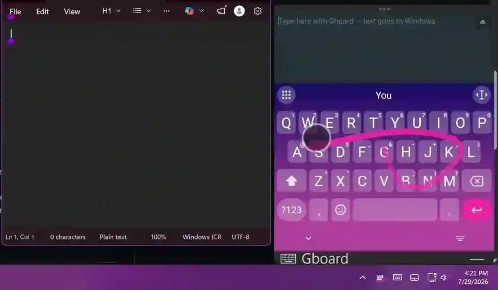
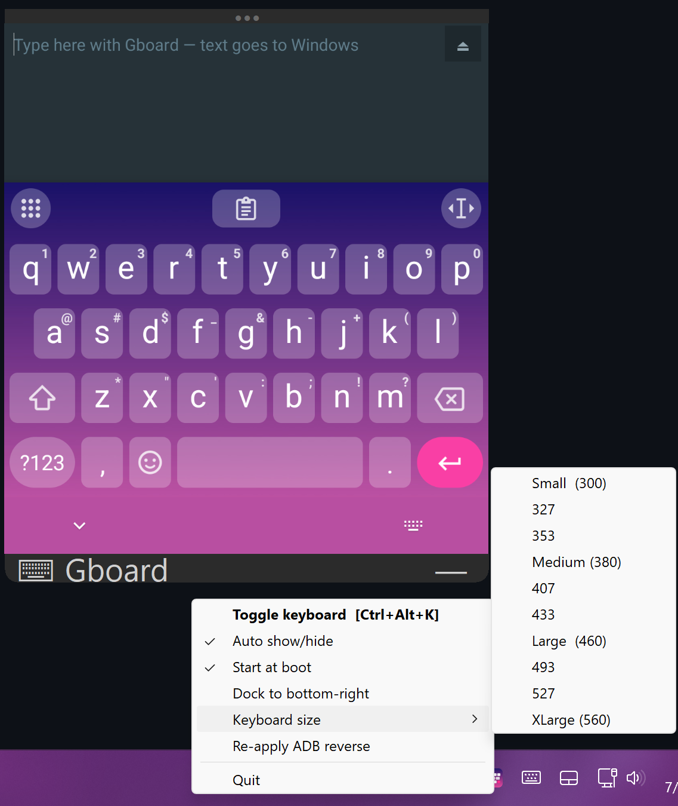

# GboardIME — Google Keyboard (Gboard) on Windows · Swipe / Glide Typing for PC

> **Use Gboard on Windows.** Get the real Google Keyboard — including swipe / glide typing,
> next-word predictions, voice typing, emoji search, multilingual layouts, and the
> clipboard manager — as a desktop IME for Windows 10 and 11. Type with your mouse or
> touchscreen the same way you type on Android.

Type and **swipe (glide / gesture type)** on the real **Google Keyboard (Gboard)** and have
the text appear in any focused Windows application. Gboard runs inside an Android emulator;
a tiny relay app captures its actual input events and forwards them to a Windows host
process that replays them with `SendInput`. Everything stays on `localhost` — no external
network is used, no telemetry, no account required.

<p align="center">
  
</p>
<p align="center">
  <em>Glide-typing on Gboard, landing live in Notepad.</em>
</p>

<p align="center">
  
</p>
<p align="center">
  <em>The floating keyboard and its tray menu — auto show/hide, start at boot, ten sizes.</em>
</p>

**Why this exists.** Windows has no first-party swipe / glide-typing keyboard and no built-in
Gboard equivalent. The Windows on-screen touch keyboard does not glide-type accurately, has
no Gboard suggestion model, and lacks Gboard features like the clipboard tool and emoji
search. GboardIME bridges the real Gboard to any Windows app so you get phone-quality typing
on a desktop — useful on touchscreen laptops, Surface devices, tablets running Windows, and
for anyone who prefers Gboard's autocorrect and gesture engine over Windows' on-screen
keyboard. **Free, open-source, fully offline.**

**Keywords:** Gboard for Windows, Google Keyboard on PC, swipe typing Windows, glide typing
desktop, Android keyboard Windows, on-screen keyboard alternative, touchscreen typing
Windows 11, Gboard desktop client, Gboard IME, virtual keyboard with swipe, Android emulator
keyboard.

```
┌──────────────────────────────┐         ┌───────────────────────────┐
│   Android emulator (AVD)      │         │        Windows host       │
│                               │         │                           │
│   Gboard  ──InputConnection── │         │   gboard_host.py          │
│      │                        │         │     listens :9877         │
│      ▼                        │         │        │                  │
│   GboardRelay app             │  ADB    │        ▼                  │
│     connects 127.0.0.1:9876 ──┼─reverse─┼──▶  SendInput → focused   │
│                               │ 9876→   │     Windows app           │
│                               │   9877  │                           │
└──────────────────────────────┘         └───────────────────────────┘
```

The relay forwards Gboard's **real** `InputConnection` operations (commit, compose, delete,
swipe-delete) rather than diffing text, so corrections, gesture typing, and backspace-swipe
behave exactly as they do on a phone.

## Repository layout

| Path | What it is |
|------|------------|
| `android/GboardRelay/` | The Android relay app (Java). Captures Gboard input and sends it over TCP. |
| `windows/gboard_host.py` | The Windows host. Receives commands and replays them via `SendInput`; system-tray icon; draggable custom title bar docked to the emulator window. |
| `windows/extras.py` | Extra key rows and columns around the keyboard (Ctrl, Alt, Shift, Win, Fn, arrows, F-keys, cut/copy/paste, custom shortcuts), themed to match Gboard. |
| `windows/extras_builder.py` | The drag and drop editor for the extra keys. |
| `windows/GboardRelay.apk` | Pre-built debug APK of the relay app. |
| `windows/debloat_removed_packages.txt` | The ~70 packages removed from the AVD to cut background load, with restore instructions. |
| `setup.ps1` | One-time bootstrap: SDK tools, system image, AVD, Python deps, builds the APK. |
| `launch.ps1` | Starts (or reuses) the emulator, sets the ADB reverse tunnel, launches the relay app, starts the host. |
| `stop.ps1` | Cleanly stops the host, relay, reverse tunnel, and emulator. |
| `setup-gpu-boost.ps1` | Optional NVIDIA smart GPU boost: raises the GPU clock only while the keyboard is showing. `-Remove` undoes it. |

`launch.ps1` and `stop.ps1` are wired to **Start GboardIME** / **Quit GboardIME** Start-menu
shortcuts.

## Requirements

- Windows 10/11
- [Android Studio](https://developer.android.com/studio) / Android SDK (`platform-tools`, `emulator`)
- A Java runtime (Android Studio bundles one at `jbr/`)
- Python 3 (host uses `pystray`, `pillow`, `uiautomation` — installed by `setup.ps1`)
- A CPU with virtualization enabled (for the x86_64 emulator) and a GPU (hardware acceleration is required for smooth swipe typing)

## Install

1. Download **`Setup.exe`** from the [latest release](../../releases/latest).
2. Double-click it. That's it — `Setup.exe` is fully self-contained (the entire project is bundled
   inside it). It unpacks to `%LOCALAPPDATA%\Programs\GboardIME` and runs the installer.

> `Setup.exe` is **signed**, but with a self-signed certificate (not a paid CA cert), so Windows
> SmartScreen will still show *"Windows protected your PC"* on first run — click
> **More info → Run anyway**. The public certificate (`setup/GboardIME-codesign.cer`) is in the
> repo if you want to inspect or trust it.

Prefer not to use the .exe? Clone the repo and run `Install.cmd` or
`powershell -ExecutionPolicy Bypass -File install.ps1` — same result.

The installer is idempotent and does everything end-to-end:

- downloads the Android SDK cmdline-tools / platform-tools / emulator if missing
- installs the `google_apis` x86_64 API-34 system image (the rootable, non-Play-Store image)
- creates the `GboardIME_Root` AVD and patches it to 1080x1180 @ 420dpi with hardware GPU rendering
- installs the Python host dependencies and the prebuilt relay APK
- cold-boots the emulator, sets Gboard as the default keyboard, sets the ADB reverse tunnel
- provisions kiosk / Lock Task mode (Device Owner) so the keyboard can't be swiped away
- debloats the emulator (Play Services, Assistant, stock apps) to cut background load
- creates **Start GboardIME** / **Quit GboardIME** Start-menu shortcuts

Switches:

```powershell
.\install.ps1 -SkipDebloat   # keep all stock apps
.\install.ps1 -SkipKiosk     # don't lock the keyboard to the foreground
.\install.ps1 -SkipEmulator  # build/install host bits only; don't boot or provision
```

Requires a Java runtime only if the prebuilt APK is missing (Android Studio bundles one). After
install, use the Start-menu shortcuts to run it.

## Run

```powershell
.\launch.ps1        # or the "Start GboardIME" Start-menu shortcut
```

Click into any Windows text field, then type/swipe on Gboard in the emulator window. Text
lands in the focused Windows app.

```powershell
.\stop.ps1          # or the "Quit GboardIME" Start-menu shortcut
```

## Extra keys

Add up to three rows (above or below the keyboard) and two columns (left or right) of PC keys
that Gboard does not have:

- **Modifiers:** Ctrl, Alt, PC Shift (for shortcuts, not just capitals), Win, and **Fn**, which
  turns the number keys into F1 to F12 and the arrows into PgUp, PgDn, Home and End.
- **Editing:** Tab, Esc, Enter, Backspace, Delete, Insert, cut, copy, paste, undo, redo, select all.
- **Navigation:** arrows, Home, End, PgUp, PgDn. **System:** Caps Lock, Num Lock, Scroll Lock,
  the right-click Menu key, Start, Print Screen, Pause. **Function keys:** F1 to F12.
- **Custom keys:** any key combo (for example Ctrl+Shift+T) or a piece of text to type.

Modifiers work together with Gboard's own keys: tap **Ctrl**, then **a** on Gboard, and you get
Ctrl+A. A single tap applies to the next key only; a quick double-tap locks it until you tap it
again. Backspace, Delete and the arrows repeat while held.

**Open the editor** with the small keyboard button at the top right of the keyboard, or from
the tray menu (**Extra keys...**). Drag keys from the list into a row or column, drag them
around to reorder, or drag one out to remove it. A plain tap on a key in the list adds it to
the row or column you picked last, which is easier with a finger. Hover a key to see its name.
Changes show on the real keyboard straight away; **Save** keeps them, **Cancel** undoes them.

**Look:** the rows match your current Gboard theme automatically, including picture themes
(**Re-read Gboard theme** after you change it), or pick a solid colour or a gradient, a text
colour, and a key size. The editor button itself can be switched off there too.

## Relay protocol (newline-delimited TCP)

**App → host** (Gboard input events):

| Command | Meaning |
|---------|---------|
| `TEXT:<chars>` | Forward these characters |
| `DEL:<n>` | Send `n` backspaces |
| `KEY:<spec>` | Send a key: `ENTER`, `TAB`, `SHIFT+LEFT`, `CTRL+A`, etc. |
| `PING` | Keepalive |

**Host → app** (Windows field sync):

| Command | Meaning |
|---------|---------|
| `CLEAR` | Reset the relay's editor buffer |
| `SYNC:<base64text>:<start>:<end>` | Replace buffer with the focused Windows field's text and cursor position |
| `CURSOR:<start>:<end>` | Update cursor/selection without changing text (mouse-click reposition) |

Commands are written on a single serialized thread so delete/text/commit sequences keep their
exact order. The host sends `SYNC:` whenever the Windows focus moves to a new text field, and
`CURSOR:` when the caret moves within the same field (e.g. a mouse click).

## Notes & quirks

- **Smooth swipe typing needs a GPU that stays awake, and GboardIME handles that for you on
  NVIDIA cards.** Gboard rebuilds a glide from the timing of each touch point. When the
  emulator's frames come out late, touch points pile up and arrive in clumps, and Gboard reads
  the wrong word. On an NVIDIA RTX 3090 Ti the card stayed parked in its idle state (P8,
  210 MHz) under the emulator's light load, and about 20% of touch points arrived clumped.
  **Smart GPU boost** (offered by the installer, NVIDIA only) raises the card's minimum clock
  to 1500 MHz only while the keyboard is on screen, and releases it 10 seconds after you hide
  the keyboard or when you quit. Measured: clumping drops to 3%, the same as running the card
  flat out, at about 38 W instead of 113 W, and back to about 33 W idle when hidden.
  It works through two scheduled tasks created once with admin approval (clock locking needs
  admin), which only ever run `nvidia-smi --lock-gpu-clocks` and `--reset-gpu-clocks`. Set it
  up later or remove it with `setup-gpu-boost.ps1` (add `-Remove` to undo).
  Avoid the NVIDIA Control Panel's *Prefer maximum performance* profile for the emulator: it
  is just as smooth but holds the card at full power the whole time the emulator runs, even
  hidden or paused. You can watch the clock with
  `nvidia-smi --query-gpu=pstate,clocks.gr --format=csv -lms 500` while you swipe.
- **The emulator runs on `-gpu host`.** Emulator 36.x has no hardware ANGLE mode (its GPU modes
  are `auto`, `host`, `software`, `lavapipe`, `swiftshader` and `swangle`). Earlier releases
  passed `-gpu angle_indirect`, which this emulator silently ignores and runs host OpenGL anyway,
  so that setting never did anything. Software rendering is much slower. Check which renderer is
  really in use from the libraries the emulator has loaded, not from the GL vendor string.
- **Glide typing with a tablet pen needs `QT_QPA_PLATFORM=windows:nowmpointer`** (also set by the
  launcher). Windows delivers pen through `WM_POINTER` but mouse through legacy messages; on the
  pointer path Qt 6.5 replays the stroke's buffered points and stamps each with the time it was
  replayed rather than drawn. Gboard reads velocity and dwell from those timings, so pen strokes
  decoded as the wrong word while mouse and finger were unaffected. Setting the option moved
  same-instant point clumps from 66.3% to 2.0% of a stroke.
  ⚠️ This option was **removed in Qt 6.8**, and the emulator suppresses Qt's unknown-option
  warning — if the SDK ships a newer emulator, pen typing regresses silently. Re-test after
  Android SDK updates.
- **The Android navigation bar is hidden** (`-prop qemu.hw.mainkeys=1`), which gives the keyboard
  back 63 px of window height. Kiosk mode already blocks Home and Recents, so the bar only cost
  space.
- **Gboard's keyboard height is capped at ~⅔ of the screen.** Presets and prefs can shrink it but
  not exceed that ceiling — this is baked into Gboard and not configurable around.
- **Kiosk / Lock Task mode** keeps the keyboard locked to the foreground so it can't be
  accidentally swiped away. The app becomes Device Owner and pins itself; Home, Recents, and the
  gesture swipe-up are all disabled. Provision once (no Google account may be present on the AVD):
  ```
  adb shell dpm set-device-owner com.gboardrelay/.RelayAdminReceiver
  ```
  This persists across reboots. To exit on purpose, use **Quit GboardIME**.
- The AVD is **debloated** (Play Services, Assistant, and dozens of stock apps removed) to reduce
  background load. Gboard's typing/swipe/prediction is fully on-device and works without Play
  Services. See `windows/debloat_removed_packages.txt` to restore anything.

## License

[MIT](LICENSE). Gboard and Google Keyboard are trademarks of Google LLC; this project does
not redistribute Gboard — you install it yourself inside the emulator.

## FAQ

**Is this an official Google product?** No. It's an independent open-source project that
relays a real Gboard install (which you provide inside the emulator) to Windows. Not
affiliated with or endorsed by Google.

**Does this work with swipe / gesture typing?** Yes — that's the main reason it exists.
Glide-typed words land in your Windows app exactly as Gboard would produce them on Android,
including the auto-spacing and corrections.

**Can I swipe-type with a tablet pen / stylus?** Yes. Pen strokes used to decode as the wrong
word while mouse and finger worked fine; that was fixed by routing pen input away from the
Windows pointer API, which was destroying the stroke's timing. Any Windows pen works — the fix
is not specific to a vendor. If pen typing ever regresses after an Android SDK update, see the
Qt 6.8 note under *Notes & quirks*.

**Swipe typing picks the wrong words — what do I check?** Frame rate first. Gboard reconstructs
a glide from per-frame samples, so anything that slows rendering makes it guess badly. Check
that your GPU is not parked in its idle state while you swipe (on NVIDIA, make sure smart GPU
boost is set up, see *Notes & quirks*), and that nothing else is maxing out your CPU. You can measure frame times
with `adb shell dumpsys gfxinfo com.google.android.inputmethod.latin`: you want a median of
about 17 ms and a 99th percentile well under 50 ms. If it only happens with a pen, see the pen
note above.

**Does it work on Windows 10? Windows 11?** Both. Any 64-bit Windows 10/11 with virtualization
enabled (for the Android emulator) and a working GPU.

**Is internet required?** No, after install. Setup downloads the Android SDK and the system
image; after that everything runs offline on `localhost`. Gboard's prediction, gesture
engine, and language model are fully on-device.

**Does this collect any data?** No. The relay is `localhost` only, no telemetry, no account.

**Can I use it on a Surface / 2-in-1 / touchscreen laptop?** Yes. This is the primary use
case — phone-style typing on Windows touchscreens.

**Why does it need an Android emulator?** Because Gboard is an Android app. The emulator
gives Gboard a real Android environment to run in; the host relays its real `InputConnection`
events to Windows. There is no open Gboard SDK or desktop build.
